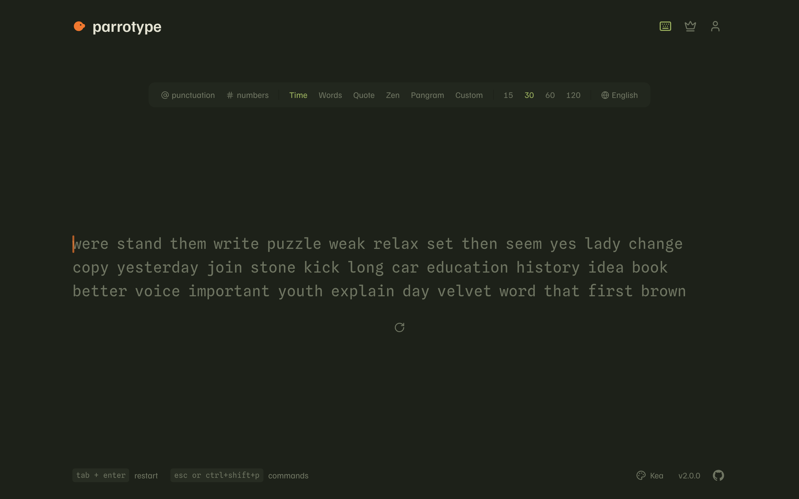
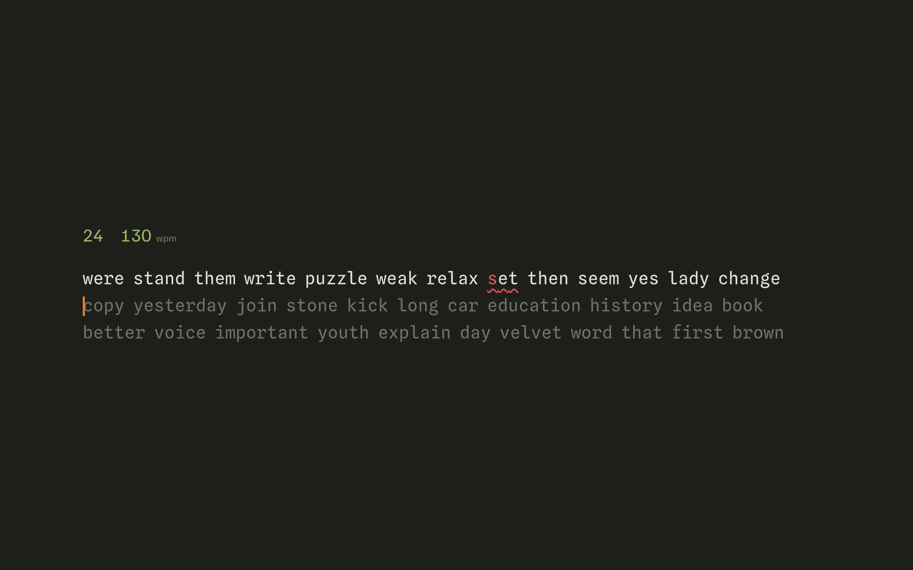
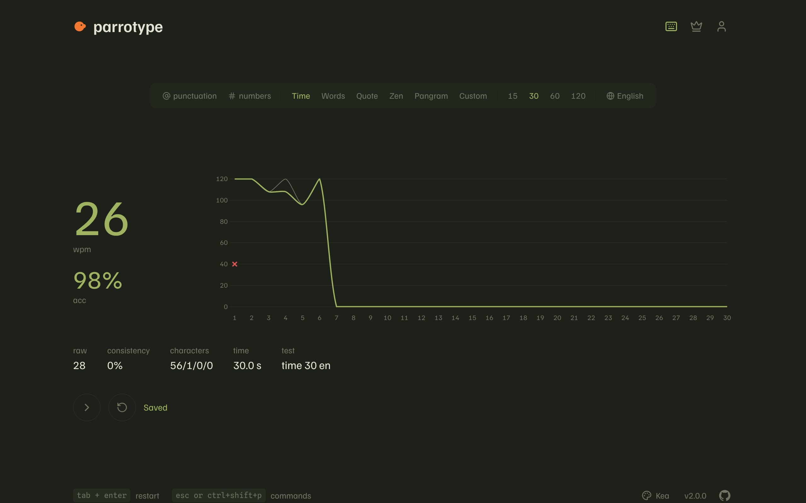

# ParroType

A minimal typing test, named after the bird that repeats what it hears. You type the text, it measures your speed, accuracy and rhythm, and keeps your history if you sign in.



| While typing | Results |
|---|---|
|  |  |

## What it does

- **Six modes**: time (15/30/60/120 s), words (10/25/50/100), quote, zen (free typing, finish with Shift+Enter), pangram and custom text. Punctuation and numbers can be mixed into time and words tests.
- **Dynamic pangrams.** Pangram mode builds a fresh sentence that uses every letter of the alphabet, each time. It runs a randomised greedy set cover over the word list, keeps the shortest candidates and checks every result. Works for English and Polish (all 32 letters, ą to ż).
- **Command line.** Press `Esc`, `Ctrl/Cmd+Shift+P` or `Ctrl/Cmd+K` to search every setting and action: mode, time, language, theme (with a live preview), font, caret style, blind mode, focus mode, stop on error, quick restart key, interface language, custom text and navigation. Searching at the top level also reaches nested options, so typing "cockatoo" finds the theme directly.
- **Results** with wpm, raw wpm, accuracy, consistency, a per-second chart with error markers, and character counts. Signed-in results are saved automatically.
- **Account page** with personal bests per mode, a progress chart with a 10-test moving average, and recent results. There's a public **leaderboard** per mode and language.
- **Eight themes named after parrots** (Kea, Kākāpō, Macaw, Cockatoo, Galah, Lorikeet, Budgie, Black Cockatoo), five monospace fonts, adjustable text size and caret style. Everything is stored locally.
- English and Polish interface.

### Keyboard

| Keys | Action |
|---|---|
| `Tab` then `Enter` | Restart (or next test on the results screen) |
| `Esc` / `Ctrl+Shift+P` / `Ctrl+K` | Open the command line |
| `Ctrl+Backspace` | Delete the current word |
| `Shift+Enter` | Finish a zen test |

## Stack

- **Frontend** (`stack/frontend`): React 19, Vite 6, TypeScript (strict), Tailwind 4, TanStack Query, zustand, react-i18next, chart.js. The typing engine is a pure reducer in `src/lib/engine` with its own test suite.
- **Backend** (`stack/backend`): NestJS 11, Prisma 6 with SQLite, zod validation.

## Getting started

Requires Node 22+.

```bash
npm run setup
```

```bash
npm run dev
```

`setup` installs dependencies, creates `stack/backend/.env` with a random JWT secret, creates the SQLite database and seeds public-domain quotes. `dev` starts the API on http://localhost:3000 and the app on http://localhost:5173. Vite proxies `/api`, so cookies stay same-origin in development.

Other scripts:

```bash
npm test
```

```bash
npm run lint
```

```bash
npm run build
```

The backend also has end-to-end tests: `npm --workspace stack/backend run test:e2e`.

## Security notes

- Sessions are HS256 JWTs in an httpOnly, SameSite=Lax cookie (`Secure` in production). Tokens are verified on every request and carry only the user id, name and a token version. Logging out bumps the version, which revokes every token issued before.
- Passwords are hashed with bcrypt (cost 12). Login gives the same error and takes the same time for an unknown email as for a wrong password.
- All input is validated with zod. Results also get a plausibility check, and zen and custom results are kept out of the leaderboard.
- Rate limiting runs globally (100/min) and is tighter on login and register (10/min). Behind a reverse proxy, set `TRUST_PROXY` to the number of hops so limits apply per client.
- helmet headers, a CORS allowlist (`CORS_ORIGINS`), a 50 kB body limit, and the configuration is validated at startup (the API refuses to start with a JWT secret shorter than 32 characters).

## License

[MIT](https://choosealicense.com/licenses/mit/)
